# Intelligent OSINT UI Tour (`ui-redesign`)

All screenshots below were captured in headless Chromium via `scripts/ui_audit.py` at desktop (`1440px`) and mobile (`375px`) viewports using a recorded investigation run (`audit_job_7a7275010f4b.jsonl`).

## 1. Launch Investigation
- **1440px**: 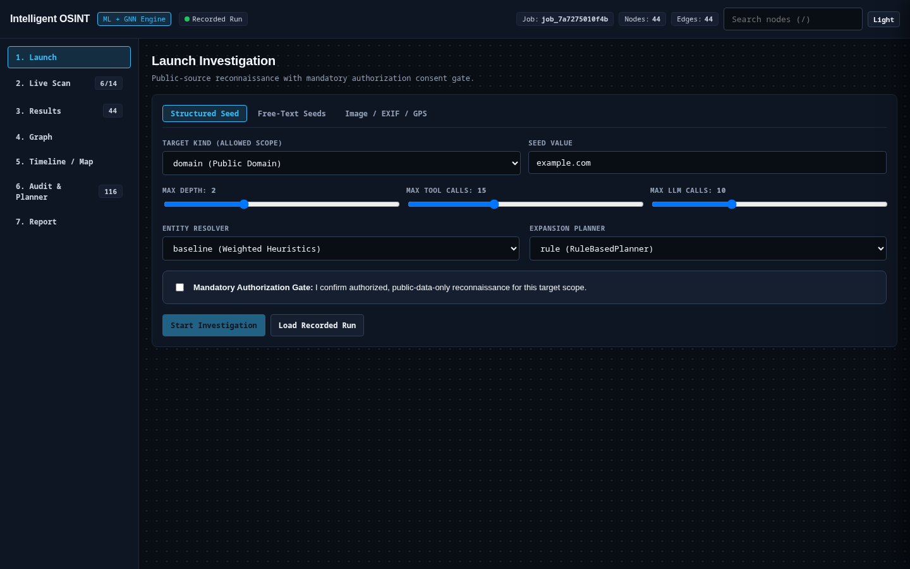
- **375px**: 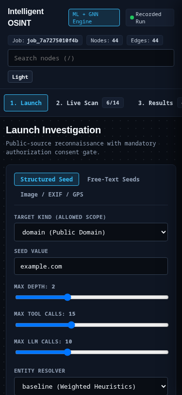

## 2. Live Scan Telemetry
- **1440px**: 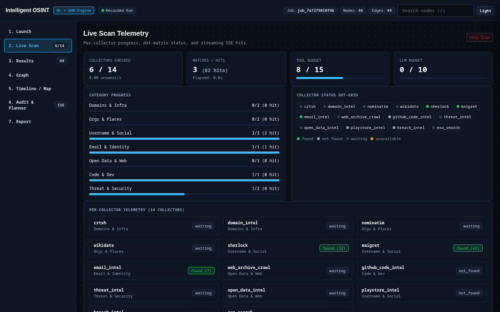
- **375px**: 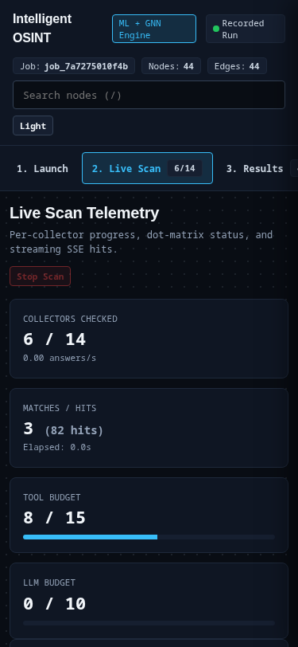

## 3. Result Cards (with Field Coverage & Sensitive Masking)
- **1440px**: 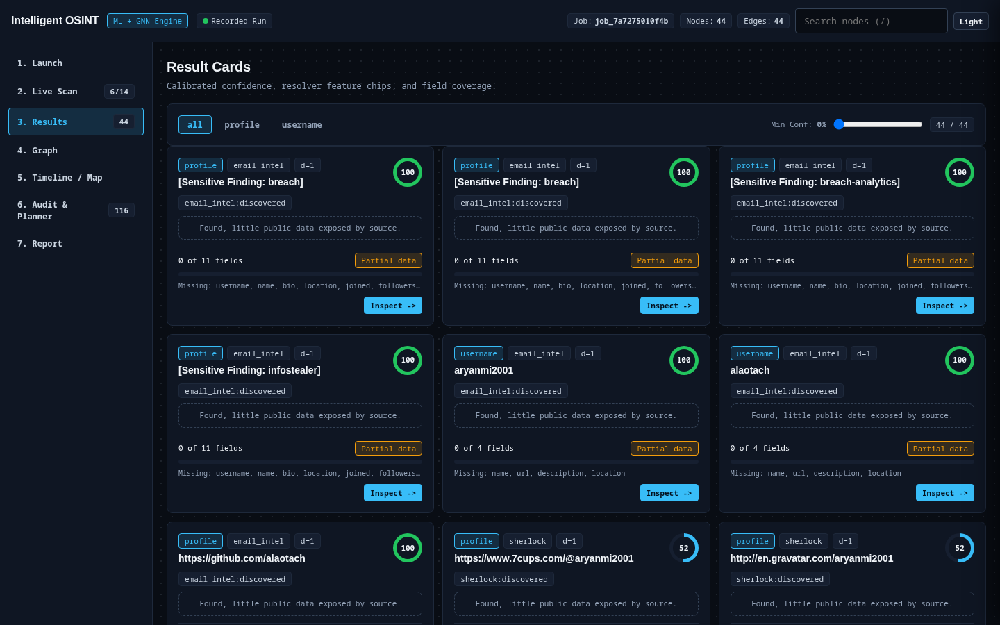
- **375px**: 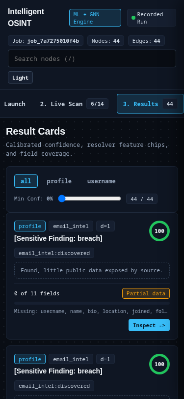

## 4. Inspector Drawer (Overview, Evidence, ML, Related, Raw JSON)
- **1440px**: 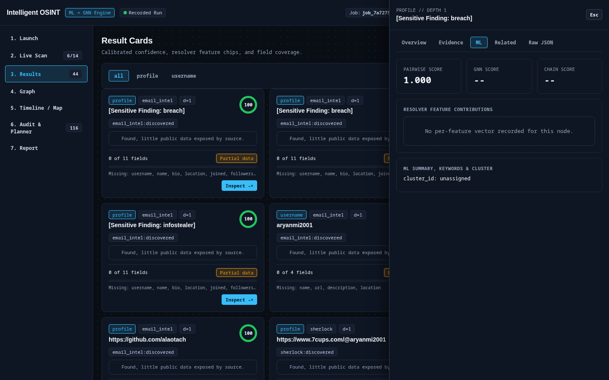
- **375px**: 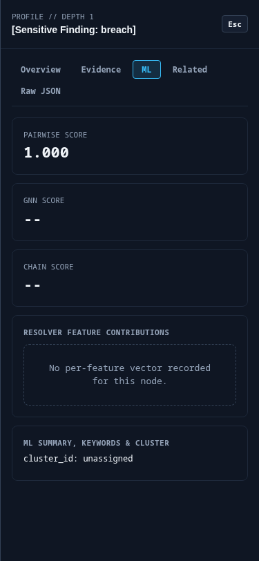

## 5. Knowledge Graph (Cytoscape.js)
- **1440px**: 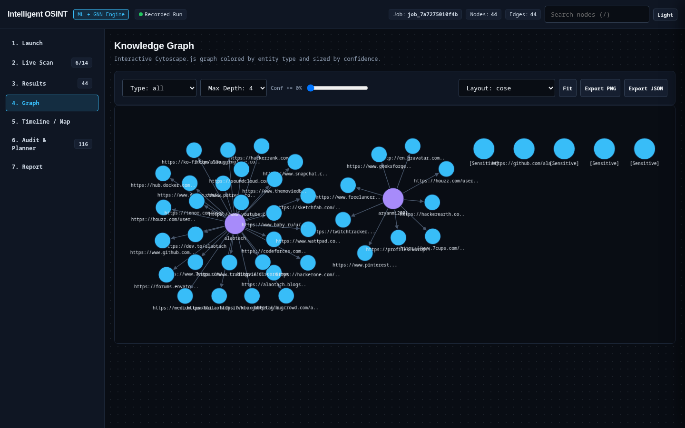
- **375px**: 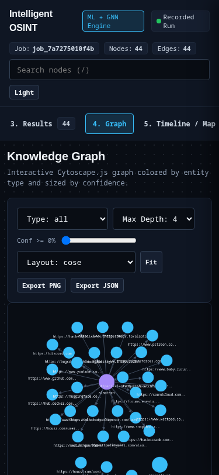

## 6. Timeline & Geo Map (Leaflet OSM)
- **1440px**: 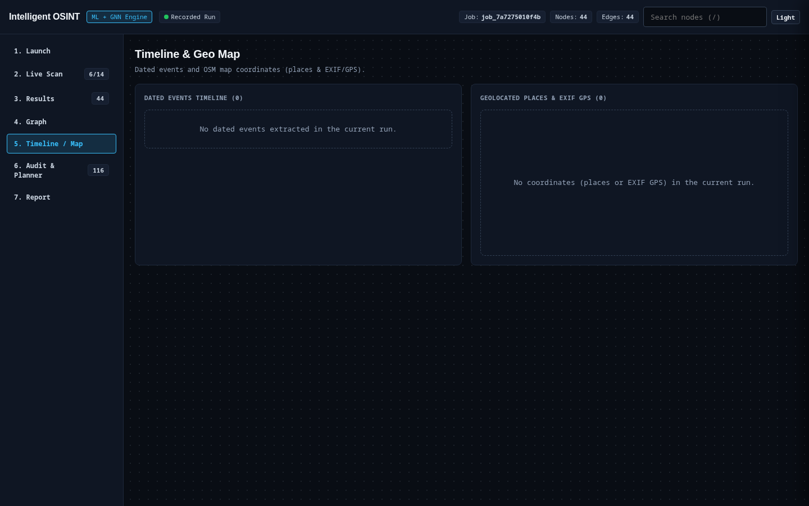
- **375px**: 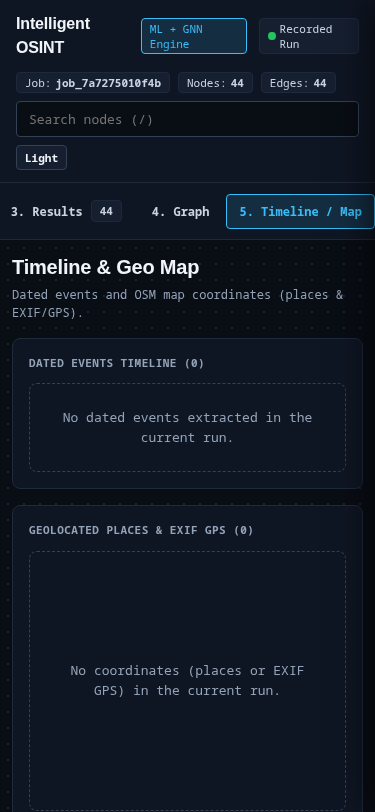

## 7. Audit Log & Planner Decisions
- **1440px**: 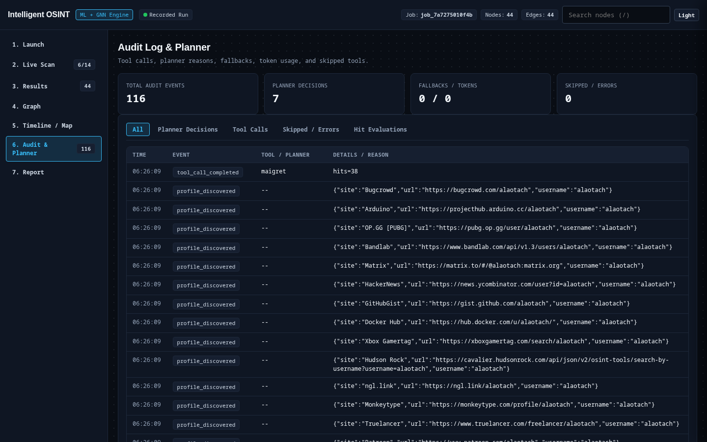
- **375px**: 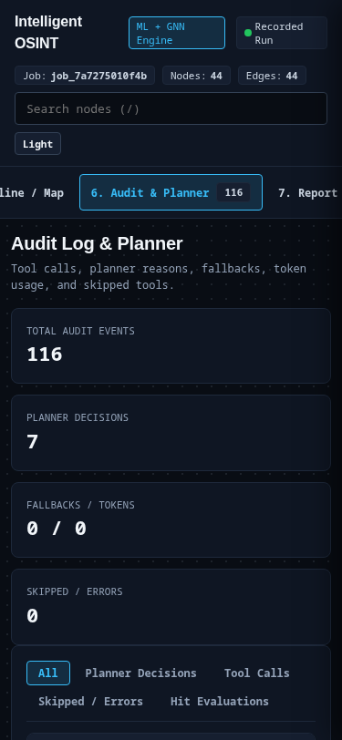

## 8. One-Page Report & Export
- **1440px**: 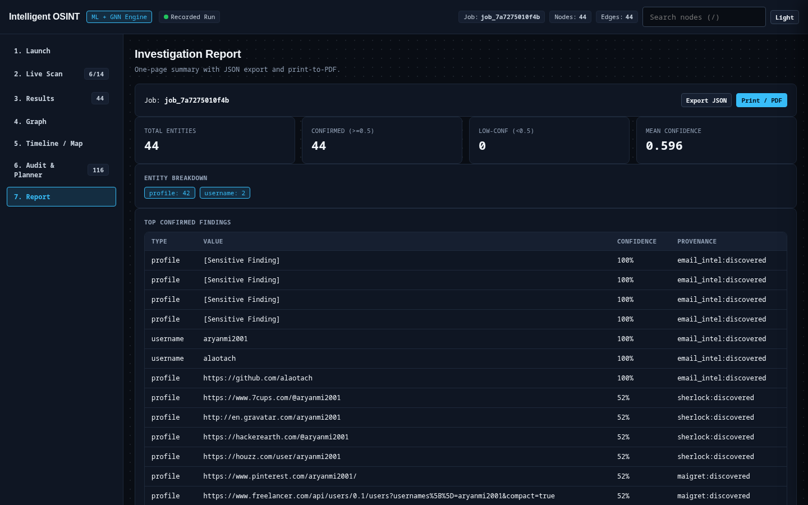
- **375px**: 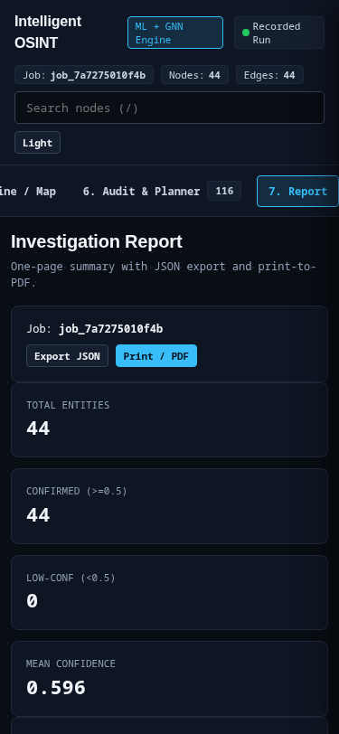
